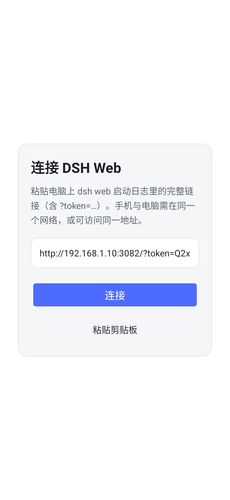
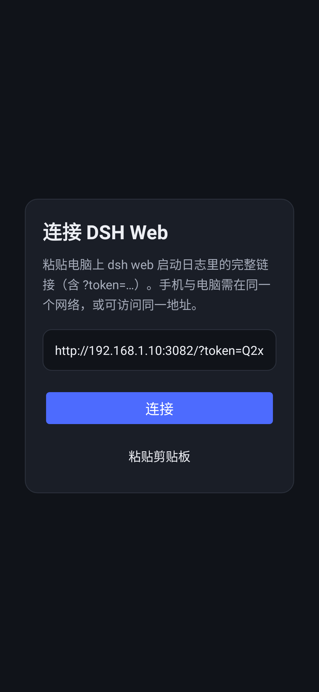
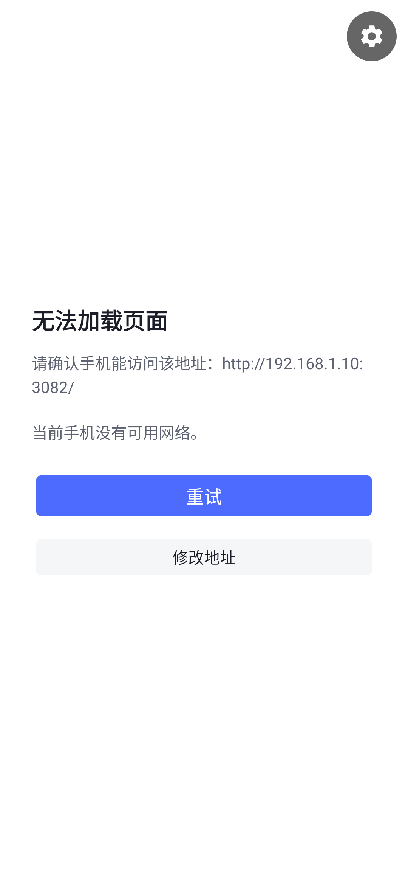

# DSH Web 安卓壳

用系统 WebView 直接加载 **DeepSeek Harness 官方 Web 版本**（`dsh web` 提供的浏览器 UI）的极简安卓 App。

壳里没有聊天逻辑，会话、工具、审批、文件全部来自官方 Web UI —— 官方怎么迭代，手机上就是最新版，不需要跟着重新发版。

> 非官方项目，与 DeepSeek 官方无关；DeepSeek / DSH 的名称与标识归其所有者。本仓库不包含任何官方代码或凭据。

## 功能

- **直接加载官方 Web 版**：无自研聊天界面，功能随官方更新
- **一次连接，之后自动重连**：首次粘贴 `dsh web` 启动日志里的完整链接（含一次性 `?token=`），换取 30 天会话 Cookie 后记住干净地址
- **全屏体验**：无浏览器地址栏，深色/浅色跟随系统
- **手机该有的行为**：硬件返回、聊天附件上传、带会话 Cookie 的下载、JS 弹窗
- **出错兜底**：断网 / 401 / 证书错误有说明页，可重试或修改地址
- **极简依赖**：Java + Android 系统框架，无 AndroidX 等第三方运行时依赖；debug APK 约 48 KB，minSdk 24 / targetSdk 34

## 界面

| 首次启动（浅色） | 首次启动（深色） | 加载失败 |
| --- | --- | --- |
|  |  |  |

连接成功后整个屏幕就是官方 DSH Web 界面（与手机浏览器打开同一地址看到的页面一致，但没有地址栏）。

## 快速开始

```sh
# 1. 电脑上启动 DSH Web，监听手机能访问的地址
dsh web --no-open --host 192.168.1.10 --port 3082

# 2. 构建或直接安装仓库里的 debug APK
cd android
./gradlew assembleDebug
adb install -r dist/dsh-web-shell-debug.apk

# 3. 打开 App，粘贴电脑打印的 `dsh web: http://192.168.1.10:3082/?token=...` 整行链接，点“连接”
```

需要 JDK 17 + Android SDK 34。完整说明（反向代理 `--trusted-host` 用法、安全边界、已知限制）见 [android/README.md](android/README.md)。

## 已知限制

- WebView 壳不是官方客户端：没有原生推送通知，不能离线使用，手机必须能访问 `dsh web` 服务
- 默认局域网明文 HTTP；公网访问请走 TLS 反向代理或内网穿透，不要把端口直接暴露到公网
- 页面由系统 WebView 渲染；过旧的 WebView（约 Chrome < 90）可能跑不动官方前端，建议 Android 10+ 或更新 WebView
- 仓库里的 APK 为 debug 签名，仅供侧载

## License

[MIT](LICENSE)。仓库内的 Gradle wrapper 归 Gradle 项目所有，遵循其各自许可证。
