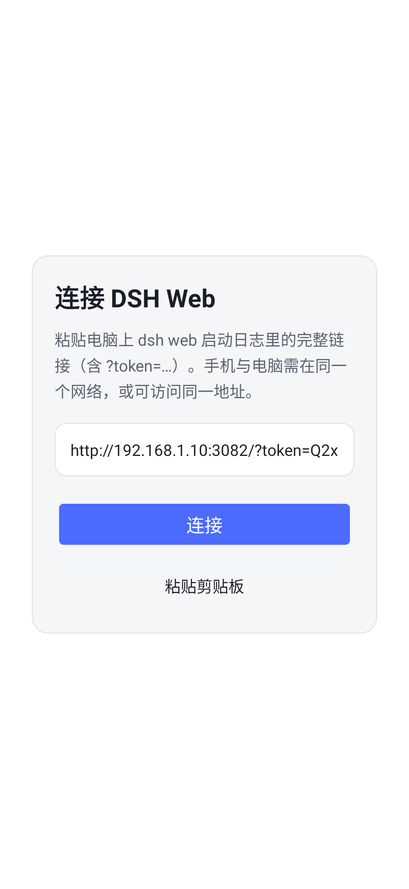
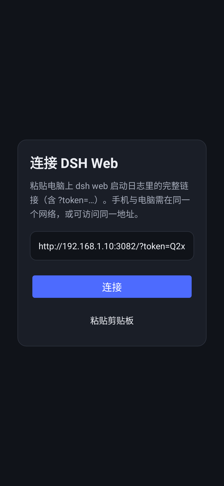
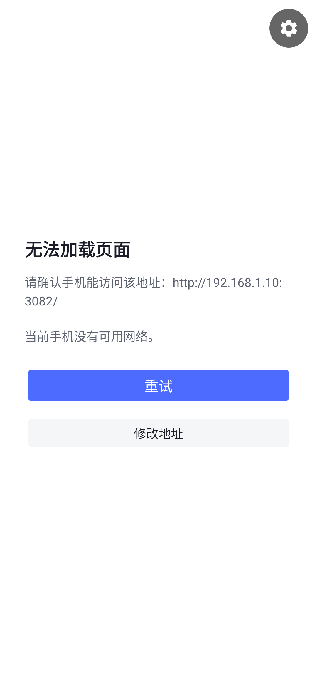

# DSH Web 安卓壳（WebView）

一个极小的安卓 App：用系统 WebView 直接加载 **DSH 官方 Web 版本**（`dsh web` 提供的浏览器 UI）。
壳只负责“打开官方页面”，不含任何聊天逻辑，所以 DSH 官方怎么迭代，手机上就是最新版，不需要跟着发版。

> 非官方项目，与 DeepSeek 官方无关；DeepSeek / DSH 名称与标识归其所有者。

- 包名：`com.dsh.webview`
- 语言 / 依赖：Java + 系统框架，**不引入 AndroidX 等第三方运行时依赖**（仅单元测试用 JUnit）
- minSdk 24（Android 7.0），targetSdk 34，compileSdk 34
- 体积：debug APK 约 40–60 KB（WebView 由系统提供）

## 实现起来简单吗？

简单。核心就是一个 `WebView` + 首次启动时填服务器地址，外加几件浏览器标签页做不好的事：

| 能力 | 说明 |
| --- | --- |
| 记住服务器 | 首次粘贴 `dsh web` 启动日志里的完整链接，之后自动重连 |
| 登录态 | 使用官方启动链接里的 `?token=` 换取会话 Cookie，Cookie 在 WebView 内持久化 |
| 全屏体验 | 无地址栏；深色/浅色跟随系统（`values-night`） |
| 硬件返回 | 网页可后退时后退，否则退出 |
| 文件上传 | 聊天里选择附件时会调起系统文件选择器 |
| 下载文件 | 转发给系统 DownloadManager，并带上 WebView 的会话 Cookie |
| 出错兜底 | 断网 / 401 / 证书错误时给出说明页面，可重试或修改地址 |

## 界面

| 首次启动（浅色） | 首次启动（深色） | 加载失败 |
| --- | --- | --- |
|  |  |  |

连接成功后整个屏幕就是官方 DSH Web 界面（与手机浏览器打开同一地址看到的页面一致，但没有地址栏）。

> 说明：当前沙箱没有可用的真机/模拟器，上面三张 App 截图由 Robolectric 的 Android layoutlib
> 按真实 `activity_main.xml`、真实资源与手机参数（1080×2340, xxhdpi）渲染。

## 构建

> **不要在承载 DSH 服务的共享 PVE 主机/容器上跑重活**：安装 Android SDK、Gradle 构建、模拟器都会挤占宿主 CPU/内存/磁盘 IO，影响 PVE 稳定性。
> 构建、单测、Lint 统一在独立构建机（JDK 17 + Android SDK 34）上执行——在仓库根目录运行：

```sh
bash scripts/remote-build.sh debug     # 或 release
```

脚本会把 `android/` 同步到构建机、在构建机上执行 `testDebugUnitTest` / `lintDebug` / `assembleDebug`（或 release），再把 APK 取回 `android/dist/dsh-web-shell-<variant>.apk`。构建机连接信息在 `~/.config/dsh/build.env`（不入库），见仓库根 README；`BUILD_DIR` 用相对构建机 `$HOME` 的路径或绝对路径（不支持 `~`）。

只有在**构建机本地**才直接执行：

```sh
cd android
./gradlew assembleDebug          # 产物：app/build/outputs/apk/debug/app-debug.apk
./gradlew testDebugUnitTest      # 单元测试（地址解析）
./gradlew lintDebug              # 静态检查
```

用 Android Studio 打开 `android/` 目录也可以直接运行。

安装（仓库 `android/dist/` 里附带最近一次构建的 debug APK，可直接侧载；也可以按上文重新构建）：

```sh
adb install -r android/dist/dsh-web-shell-debug.apk
# 或
adb install -r android/app/build/outputs/apk/debug/app-debug.apk
```

## 使用

1. 在电脑上启动 DSH Web，监听一个手机能访问的地址（`--host` 必须是本机具体 IP，不支持 `0.0.0.0`）：

   ```sh
   dsh web --no-open --host 192.168.1.10 --port 3082
   ```

   终端会打印一行带启动令牌的链接，例如：

   ```
   dsh web: http://192.168.1.10:3082/?token=AbC123…
   ```

2. 手机与电脑连同一个 Wi-Fi（或手机能路由到该地址），确认电脑防火墙放行 3082 端口。
3. 打开 App，把上面**整行链接**粘贴进输入框（点“粘贴剪贴板”），点“连接”。
   App 会用 `?token=` 换到 30 天有效的会话 Cookie，此后记住的地址是不含令牌的干净地址。
4. 令牌过期（例如重启过 `dsh web`）后，页面会提示 401，重新复制最新链接在设置里修改地址即可。

### 通过域名 / 反向代理访问

DSH 有 Host/Origin 信任栅栏：监听地址本身被接受，其他 authority 需要在启动时显式信任，例如：

```sh
dsh web --no-open --host 192.168.1.10 --port 3082 \
  --public-url https://dsh.example.com/ --trusted-host dsh.example.com
```

证书必须被系统信任且覆盖你访问的地址（WebView 不会忽略证书错误）。

## 安全与限制

- 启动链接里的 `token` 是进程凭据，等同于 DSH Web 的登录入口；不要发到公开地方。
- 默认是局域网明文 HTTP，**不要**把 3082 端口直接暴露到公网；公网访问请走 TLS 反向代理或内网穿透。
- App 只信任系统证书，不提供“忽略证书错误”开关。
- 这是一个 **WebView 壳**，不是官方客户端：没有原生推送通知，也无法离线使用；手机必须能访问 DSH Web 服务。
- 页面由系统 WebView 渲染，会随 Chrome / 系统 WebView 更新；过旧的 WebView（大约 Chrome < 90）可能跑不动官方前端，建议 Android 10+ 或更新 WebView 后再用。minSdk 24 只是能安装的下限。
- 官方 Web 版本的 PWA manifest 是 `display: fullscreen`，但 http 局域网地址不满足浏览器安装 PWA 的安全上下文要求，所以这里用原生壳来获得接近原生的全屏体验。

## 调试

- 带地址直接启动：`adb shell am start -n com.dsh.webview/.MainActivity --es url 'http://192.168.1.10:3082/?token=…'`
- WebView 远程调试：安装 debug 包后用桌面 Chrome 打开 `chrome://inspect`。
- 修改地址：网页右下角/右上角的齿轮按钮 → “修改服务器地址”；也可“清除登录状态（Cookie）”强制重新登录。

## 目录结构

```
android/
├── app/src/main/AndroidManifest.xml
├── app/src/main/java/com/dsh/webview/MainActivity.java   # WebView 壳的全部逻辑
├── app/src/main/java/com/dsh/webview/UrlNormalizer.java  # 粘贴链接解析（可单测）
├── app/src/main/res/                                     # 布局、主题、图标（浅色/深色）
├── app/src/test/java/com/dsh/webview/UrlNormalizerTest.java
├── build.gradle.kts / settings.gradle.kts
└── gradle/ + gradlew                                     # Gradle 8.9 wrapper
```

## License

[MIT](../LICENSE)。仓库内的 Gradle wrapper 归 Gradle 项目所有，遵循其各自许可证。
